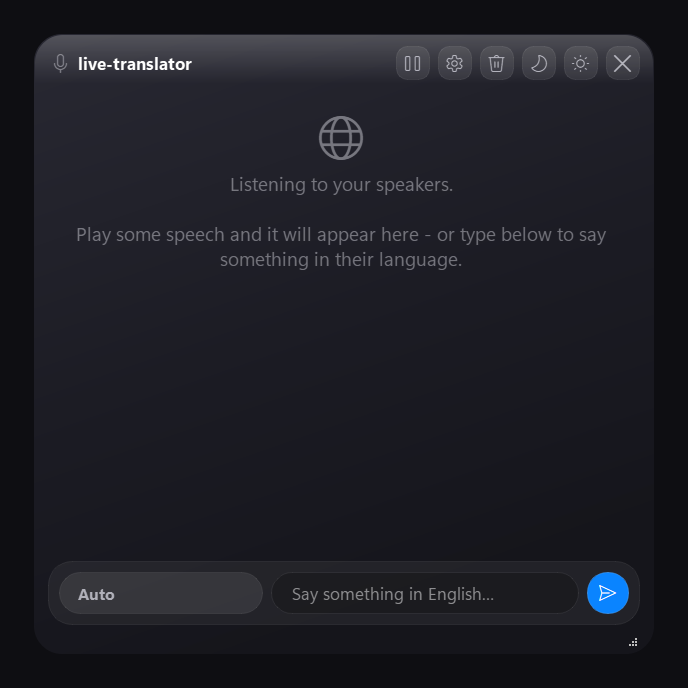

# live-translator

[](LICENSE)


Translates what other people say in Discord or game voice chat, live, in a small window
that sits on top of your game.

It records your speakers, not your microphone, so it hears the other people in the call.
When someone speaks a language you don't know, you get their words, the translation, and
a few replies you can send back in their language. You can also type in English and get
it translated



## How to start it

Double-click **`live-translator.bat`**.

That opens the overlay. Right-click that file and pick Send to, then Desktop, if you
want a shortcut you can launch from anywhere.

If you prefer PowerShell:

```powershell
cd C:\path\to\live-translator
.\run.ps1
```

Close it with the X in the corner.

## Installing it

You need Windows 10 or 11 and an NVIDIA GPU with 6 GB of memory. It works without a GPU
but runs about 20 times slower. Set aside 8 GB of disk for the models.

Install Python and Ollama:

```powershell
winget install --id Python.Python.3.11 --scope user
winget install --id Ollama.Ollama
```

Close PowerShell and open it again so it finds the new commands. Then:

```powershell
git clone https://github.com/codext4fn-afk/live-translator.git
cd live-translator
.\setup.ps1
```

`setup.ps1` does the rest: virtual environment, Python packages, language model, config
file. Then it checks everything and tells you if something is missing. Takes about ten
minutes, mostly downloading.

Now start it with `live-translator.bat`. The first launch downloads the speech model,
about 1.6 GB. After that it opens in under a second

If setup goes wrong, run `.\run.ps1 --check`. It tests each piece and says what failed.

## Using it

Each card shows the language, what they said, the translation in bold, then numbered
replies you can send. Click a reply to copy it, then paste it in your chat.

For languages that don't use our alphabet there is a pronunciation line under each
reply, so you can read Japanese or Arabic out loud.

The bar at the bottom goes the other way. Type in English, press Enter and you get it
in their language.

Drag the window from anywhere that isn't a button. The corner resizes it. The buttons
along the top are pause, settings, clear, dim, brighten, close.

Settings changes the window colour and the language you want everything translated into.

## Settings

Everything is in `config.toml`, and every setting has a comment explaining it. The ones
you might want to change:

| Setting | Default | What it does |
| --- | --- | --- |
| `languages.my_language` | English | The language you want things translated into. |
| `languages.ignore_languages` | `["en"]` | Languages to skip completely. English is skipped because you already speak it. |
| `languages.allowed` | 13 languages | Which languages it will try to detect. Cut this down to the ones you actually hear. |
| `audio.silence_ms` | 700 | How long someone has to stop talking before it counts as the end of a sentence. |
| `suggest.count` | 3 | How many replies to write. Two is faster. |
| `suggest.model` | `qwen3:4b` | Any model you have in Ollama. |
| `ui.font_size` | 13 | Text size. Everything scales with it. |

### English doesn't show up

That is on purpose. You already speak it, so it gets dropped before anything else
happens. It also makes everything faster, because in a mostly English call there is
almost nothing left to do.

If you want English lines with replies too, remove `"en"` from `ignore_languages`.
Changing your language in Settings updates this for you.

### Only hearing the voice chat

By default it hears everything your speakers play, music and game sounds included, and
tries to translate all of it.

To fix that, send only the voice chat to its own audio device:

1. Settings, then System, then Sound, then Volume mixer.
2. Find Discord and set its Output device to something other than your speakers. A free
   virtual audio cable like VB-Audio Virtual Cable works well here.
3. Put that device in `config.toml`:

```toml
[audio]
device = "CABLE"
```

`.\run.ps1 --list-devices` lists the names you can use.

## Speed

On an RTX 3070:

| | |
| --- | --- |
| Window opens | 0.4 s |
| Ready to listen | 3 to 6 s |
| Detects end of a sentence | 0.7 s |
| Transcribes it | 0.5 s |
| Translation appears | 0.4 s later |
| Replies appear | 1.3 to 2.2 s |
| Typed translation | 0.4 to 0.9 s |

Transcribing is fast. Writing the replies is the slow part, and it depends on how much
the model writes, so `suggest.count` changes speed more than anything else.

It uses about 2 GB for the speech model and 3 GB for the language model. That leaves
3 GB free on an 8 GB card. If a game needs it back, set `asr.compute_type` to `int8`.

## When something breaks

Run `.\run.ps1 --check` first. It tests each part and names the problem.

**Nothing shows up.** Check it is listening to the right device. `--list-devices` shows
what is available, then put part of the name in `[audio].device`.

**The words are wrong.** Sentences are probably getting cut too short. Open
`logs\live-translator.log`:

```
heard 3.8s en(0.74) in 0.55s: 'How much do you like it?'
filtered (fragment (0.41s of audio)): 'you'
```

If those times are around a second, it is chopping people off mid sentence and guessing
at the rest. Raise `audio.silence_ms`. Cutting `languages.allowed` down to the languages
you actually hear helps too.

**It got slow.** The log tells you which problem it is. `suggested in 1.4s` is normal.
Tens of seconds means a game took the GPU memory, and it says so directly:
`qwen3:4b is only 40% on the GPU`. Close something or set `asr.compute_type` to `int8`.
One slow result after a quiet spell is just the model loading back in.

**It translates my music.** See [Only hearing the voice chat](#only-hearing-the-voice-chat).

**The window is invisible in a game.** Fullscreen games draw over everything. Set the
game to Borderless or Windowed.

**It says Ollama is not connected.** Start Ollama from the Start menu, or run
`ollama serve`.

## Commands

| | |
| --- | --- |
| `.\run.ps1` | Start it |
| `.\run.ps1 --check` | Test everything and show the audio device |
| `.\run.ps1 --demo` | Show the window with fake content, no audio or models |
| `.\run.ps1 --list-devices` | List audio devices |
| `.\run.ps1 --language es` | Skip detection, assume one language |
| `.\run.ps1 --no-suggest` | Translate only, no replies |
| `.\run.ps1 --debug` | Verbose logging |

## How it works

```
speakers
  - WASAPI loopback capture, resampled to 16 kHz mono
  - voice detection with an adaptive noise gate
  - faster-whisper large-v3-turbo on CUDA
  - qwen3:4b through Ollama, streamed
  - overlay
```

Things worth knowing if you want to change it:

It waits for a real pause before ending a sentence. Give the speech model a one second
fragment and it guesses at both the words and the language, which is where wrong
translations come from. Once someone has been talking a while it starts cutting at
smaller pauses so you are not waiting for them to finish.

The model reply is read as it arrives. The translation is the first thing it writes, so
it appears while the replies are still being generated.

Transcripts get filtered before you see them. Speech models make things up when they
hear music or silence, usually subtitle junk like "Thanks for watching". Results are
scored on confidence, length, repetition and language, and anything that looks invented
is thrown away. Every rejection is in the log with a reason.

Nothing is saved to disk except the log.

## Models

`suggest.model` takes anything you have in Ollama. `qwen3:4b` is the default.
`gemma3:4b` is worth a try if you prefer how it translates.

```powershell
.\run.ps1 --suggest-model gemma3:4b
```

A 4B model is good but not perfect. Expect the odd grammar mistake in a reply, so read
the English underneath before you send it. Pronunciation lines are close enough to be
understood, not exact. `qwen3:8b` is better at both if you have the memory.

## Files

```
src/livetranslator/
  audio.py     loopback capture and resampling
  vad.py       speech detection and sentence boundaries
  asr.py       transcription and filtering
  suggest.py   translation and replies via Ollama
  overlay.py   the window
  theme.py     colours, fonts, icons
  motion.py    animations
  glass.py     Windows window effects
  pipeline.py  threading
```


## Privacy

Audio is handled in memory and never saved. The only file it writes is
`logs\live-translator.log`, which has transcribed text in it for troubleshooting. It is
not uploaded anywhere and git ignores it. Delete it whenever you like.

This records calls you are part of. Recording other people may need their permission
where you live.

## Note
If you'd like to talk to me about this repo or have some feedback you can also dm me on discord: doug.l0as

## Licence

Apache 2.0. See [LICENSE](LICENSE) and [NOTICE](NOTICE).
